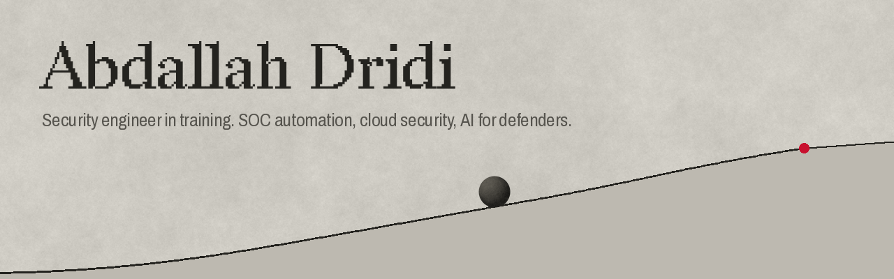

<picture>
  <source media="(prefers-color-scheme: dark)" srcset="./assets/banner-dark.png">\
  
</picture>

Cybersecurity engineering student moving from offensive security to blue team work: SOC operations, detection engineering and the automation behind them.

Looking for a six-month internship (PFE) in France from **February 2027**: SOC automation, incident response, cloud security or practical AI security.

[abdallah-dridi.me](https://abdallah-dridi.me) · [Email](mailto:dridi.abdallah1@gmail.com) · [LinkedIn](https://www.linkedin.com/in/abdallah-dridi-93589a184/)

 

### Works

**_Orchestryx_**\
Cloud security\
A cloud-native cyber range and CTF platform that provisions isolated environments asynchronously on AWS.\
Medium: AWS, AWS CDK, FastAPI, PostgreSQL, SQS, Celery, Cognito, Docker

**_Latrodectus_**\
Malware analysis, academic\
Triage, static and sandbox analysis of a real Windows loader, with IOCs, MITRE ATT&CK mapping, YARA and detection opportunities.\
Medium: Detect It Easy, peframe, FLOSS, capa, YARA, Triage

**_WireCat_**\
Network analysis\
A real-time packet analyzer: live capture, Ethernet, IP and TCP inspection, protocol filters, export to .pcap, .csv and .txt.\
Medium: Java, JavaFX, Pcap4J, Maven

**_Kooretna_**\
AI, retrieval\
A football statistics assistant built on the Groq API and a RAG pipeline fed by sports APIs.\
Medium: Groq API, LangChain, RAG

**_SOC automation at Amen Bank_**\
Internship, June to September 2026\
Splunk SOAR playbooks for alert triage, threat-intel enrichment with MISP and VirusTotal, Gemini-assisted alert analysis.\
Medium: Splunk SOAR, MISP, VirusTotal, Gemini API

 

### What I carry

AWS Certified Solutions Architect – Associate · RHCSA · eJPT · Google IT Automation with Python

Working toward: AWS Certified Security – Specialty · CKA · CyberDefenders Blue Team Level 1
