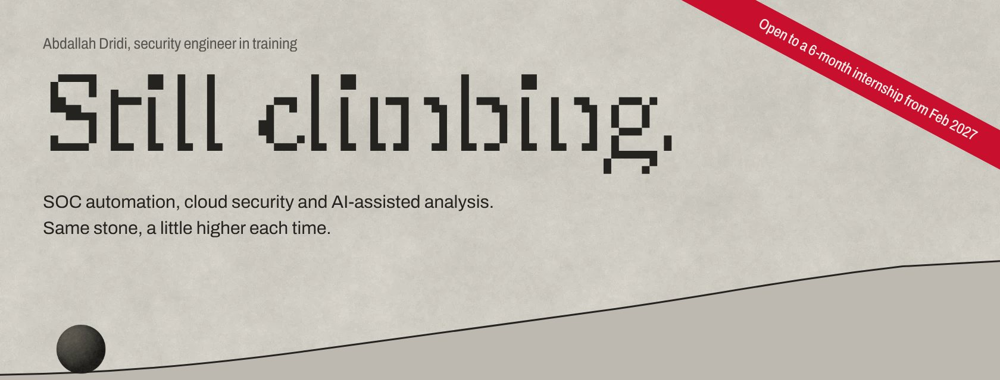
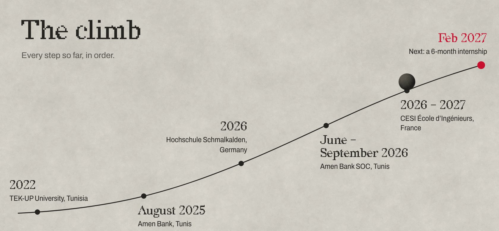
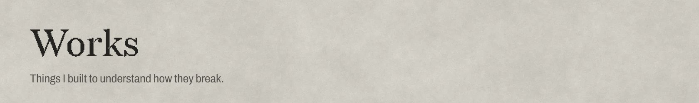
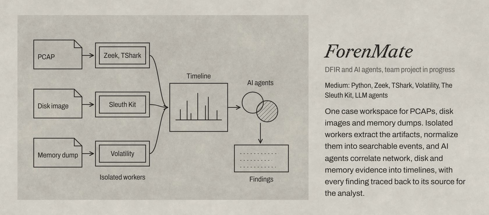
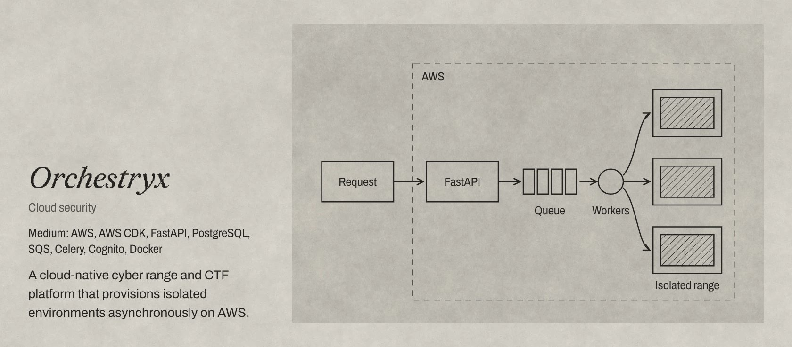
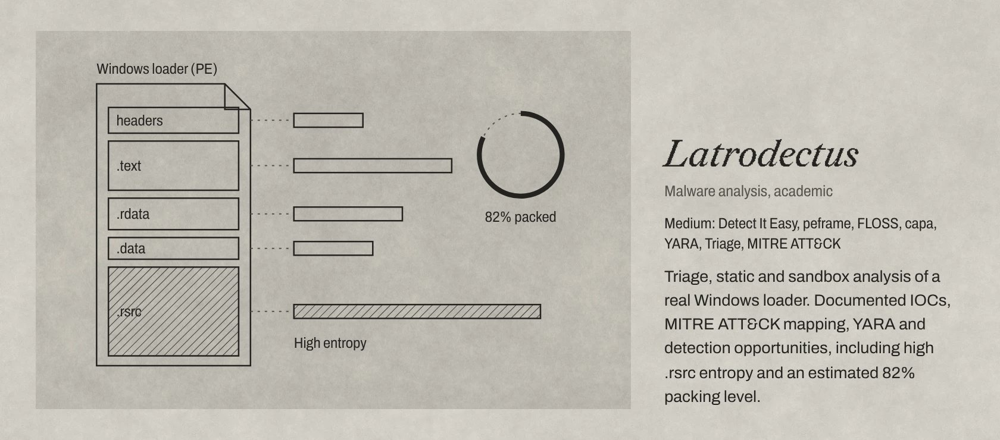
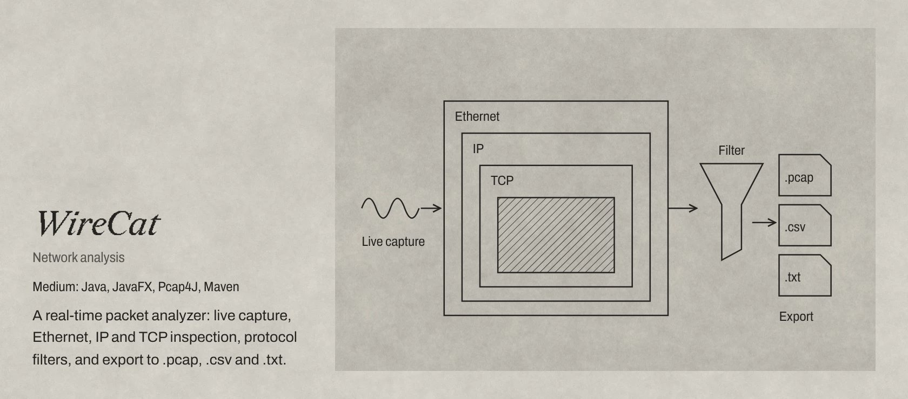
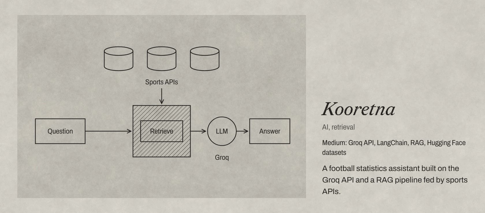
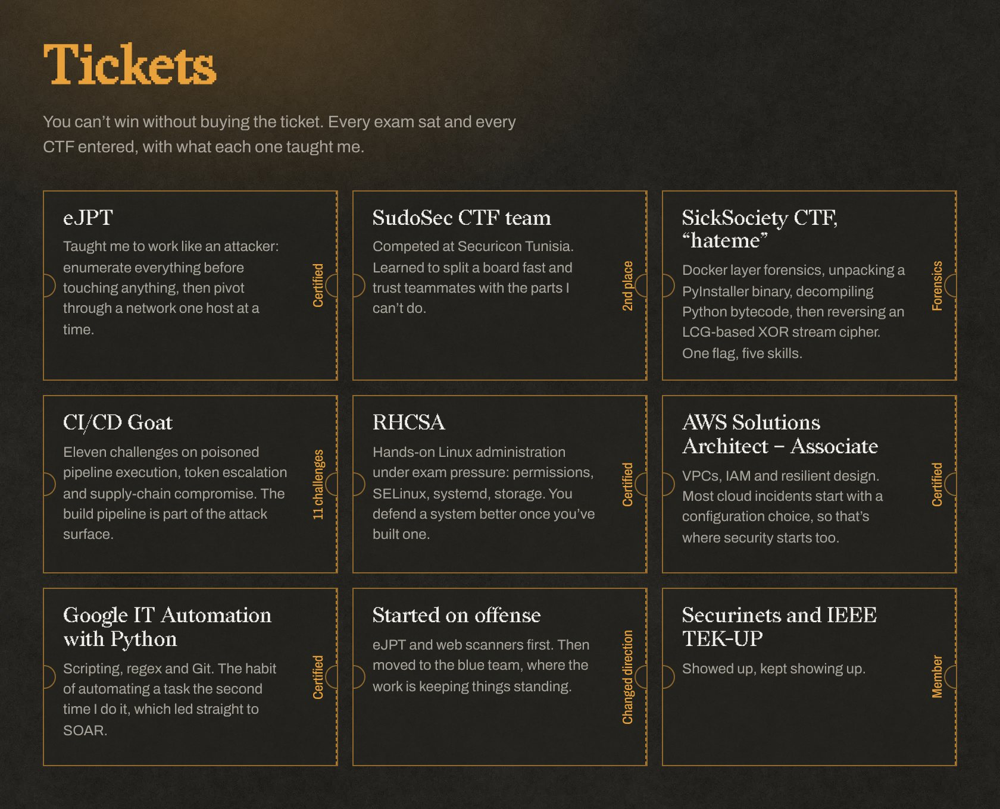
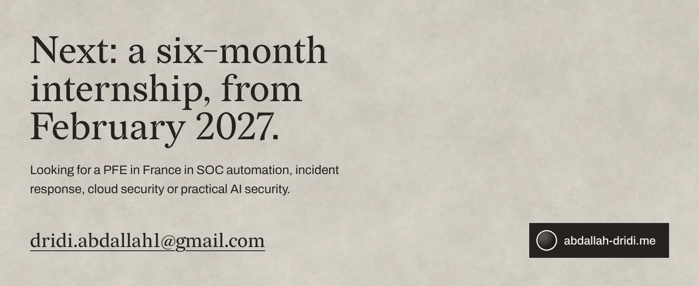

<picture>
  <source media="(prefers-color-scheme: dark)" srcset="./assets/banner-dark.jpg">
  
</picture>

 

Cybersecurity engineering student moving from offensive security to blue team work: SOC operations, detection engineering and the automation behind them.

[abdallah-dridi.me](https://abdallah-dridi.me) · [Email](mailto:dridi.abdallah1@gmail.com) · [LinkedIn](https://www.linkedin.com/in/abdallah-dridi-93589a184/)

 

  

  

  

 

[Email me](mailto:dridi.abdallah1@gmail.com) · [Visit the site](https://abdallah-dridi.me) · [LinkedIn](https://www.linkedin.com/in/abdallah-dridi-93589a184/)
